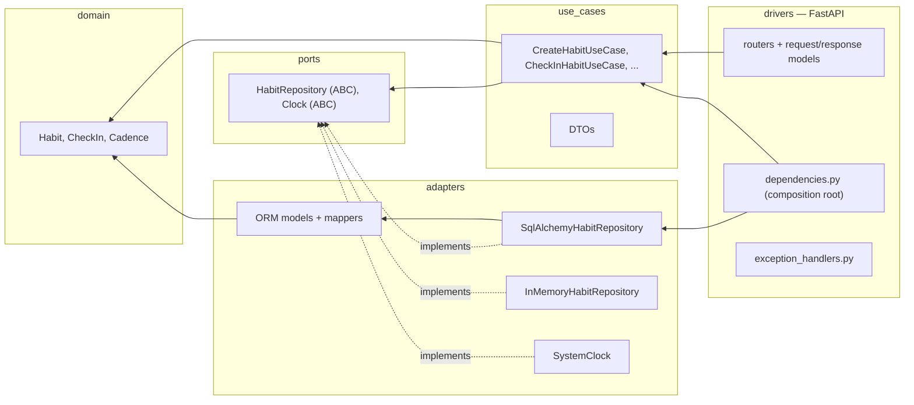

# Architecture

This project follows **Clean Architecture** as described in
[“Clean Architecture with Python”](https://medium.com/@shaliamekh/clean-architecture-with-python-d62712fd8d4f)
and its [reference repository](https://github.com/shaliamekh/clean-architecture-fastapi).
The layer names here are the article's, unchanged.

Everything on this page is enforced by `import-linter` in CI (`uv run lint-imports`).
If a rule below is not enforceable by a tool, it says so explicitly.

---

## 1. The layers

```
src/app/
├── domain/      entities, value objects, their invariants
├── ports/       abstract interfaces the core needs from the outside world
├── use_cases/   application logic, one class per operation, plus the DTOs
├── adapters/    concrete implementations: PostgreSQL, Redis, the ORM, the clock
├── drivers/     FastAPI: routers, request/response models, DI wiring, error mapping
└── config/      settings (infrastructure — inner layers may not import it)
```



### The dependency rule

**Source code dependencies point inwards only.** An inner layer must never name an
outer one.

| Layer       | May import                            | Must never import                              |
| ----------- | ------------------------------------- | ---------------------------------------------- |
| `domain`    | the standard library                  | anything else in `app`, any third-party package |
| `ports`     | `domain`                              | `use_cases`, `adapters`, `drivers`, frameworks  |
| `use_cases` | `ports`, `domain`                     | `adapters`, `drivers`, frameworks, `config`     |
| `adapters`  | `use_cases`, `ports`, `domain`, `config` | `drivers`                                    |
| `drivers`   | everything                            | —                                              |

Concretely: **`fastapi`, `sqlalchemy`, `pydantic`, `redis` and `alembic` may not be
imported from `domain`, `ports` or `use_cases`.** That is contract #2 in
`pyproject.toml`, and it is the rule that makes the rest of this possible.

The arrow from a use case to a database is inverted with an interface: the use case
depends on `ports.repositories.HabitRepository`, and
`adapters.repositories.sqlalchemy.SqlAlchemyHabitRepository` depends on that same
interface. Neither knows about the other.

### The composition root

`drivers/rest/dependencies.py` is the **only** module that decides which adapter is
used. Swapping PostgreSQL for something else, or HTTP for a message consumer, is an
edit there plus a new adapter — no use case, port or entity is touched.

---

## 2. The three model types

There are exactly **three kinds of model** in this codebase, one per boundary, plus
the domain objects, which are not "models" at all. Never let one do another's job.

| # | Kind | Lives in | Built with | Crosses | Purpose |
| - | ---- | -------- | ---------- | ------- | ------- |
| 1 | **Request / response model** | `drivers/rest/schemas/` | Pydantic `BaseModel` | the network | The public HTTP contract. What the API accepts and returns, and what OpenAPI documents. |
| 2 | **DTO** | `use_cases/dto/` | frozen `dataclass` | layer boundaries inside the app | The input and output type of a use case. Plain data, no behaviour, no framework. |
| 3 | **ORM model** | `adapters/orm/models.py` | SQLAlchemy `DeclarativeBase` | the database boundary | The shape of a row in PostgreSQL. A persistence detail. |
|   | *(domain entity / value object)* | `domain/` | plain `dataclass` | never leaves `domain` + `use_cases` | The business object. Owns the rules and the invariants. |

### Why they are separate

The three boundaries change for different reasons and at different times. A column
rename must not break the public API. A new API field must not force a migration.
Keeping one class for all three ties every boundary to every other, which is the
coupling this architecture exists to prevent.

### Hard rules

- A **Pydantic model must never reach a use case.** Routers convert to a DTO first.
- A **use case must never receive or return an ORM model.** Repositories return entities.
- An **ORM model must never leave `app.adapters`.** Mappers convert at the edge.
- A **domain entity must never be serialised to HTTP.** Use cases project it into a DTO.
- **DTOs carry no behaviour and no validation.** Structural validation belongs to the
  request model; business validation belongs to the entity.

Rules 1–3 are covered by the import contracts. Rules 4–5 are review-time rules.

### Who owns each conversion

| Conversion | Owned by | Looks like |
| ---------- | -------- | ---------- |
| request model → DTO | the request model | `CreateHabitRequest.to_dto()` |
| entity → DTO | the DTO | `HabitDTO.from_entity(habit, as_of=now)` |
| DTO → response model | the response model | `HabitResponse.from_dto(dto)` |
| entity ↔ ORM model | a mapper module | `adapters/orm/mappers.py` |

Each conversion lives on the side that is allowed to know both types. That is why
`from_entity` sits on the DTO (the application layer may see the domain) and
`from_dto` sits on the response model (the drivers layer may see the DTO).

### One request, end to end

`POST /habits/{id}/check-ins`:

```
HTTP JSON
  → CreateCheckInRequest      (Pydantic: is the payload well-formed?)
  → CheckInHabitDTO           (.to_dto)
  → CheckInHabitUseCase       (is the habit there? is the timestamp sane?)
      → HabitRepository.get   (port)
          → SqlAlchemyHabitRepository  (adapter)
              → SELECT … → HabitModel → habit_to_entity() → Habit
      → Habit.check_in()      (domain: cadence rule, archived rule)
      → HabitRepository.add_check_in → check_in_to_model() → INSERT
  → HabitDTO.from_entity      (streak and completion resolved here)
  → HabitResponse.from_dto    (camelCase JSON)
HTTP 201
```

---

## 3. Errors

Each layer raises errors in its own vocabulary; the layer above translates.

| Raised in | Base class | Examples | Becomes |
| --------- | ---------- | -------- | ------- |
| `domain` | `DomainError` | `CadenceAlreadyMetError`, `InvalidHabitNameError` | 409 / 422 |
| `use_cases` | `ApplicationError` | `HabitNotFoundError`, `FutureCheckInError` | 404 / 422 |
| `adapters` | `ExternalError` | `DatabaseError`, `CacheError` | 503 |

- An exception from a library (`sqlalchemy.exc.*`, `redis.exceptions.*`) **must not
  escape the adapter that caused it.** Wrap it in an `ExternalError` subclass.
- `HTTPException` and status codes appear **only** in `drivers`. The mapping lives in
  `drivers/rest/exception_handlers.py`.
- Every failing endpoint returns the same body: `{"message": "..."}` (`ErrorResponse`).

---

## 4. Tests

| Suite | Location | Runs against | Needs |
| ----- | -------- | ------------ | ----- |
| Domain | `tests/unit/domain/` | entities directly | nothing |
| Use cases | `tests/unit/use_cases/` | `InMemoryHabitRepository` + `FixedClock` | nothing |
| Repositories | `tests/integration/adapters/` | real PostgreSQL | a database |
| HTTP | `tests/integration/drivers/` | the real app, in-memory adapters | nothing |

The in-memory repository is a genuine implementation of the port, not a mock, so unit
tests exercise the same code paths production does. The HTTP tests swap only the
adapters via `app.dependency_overrides`, so routing, validation, the use cases and
the domain rules all run for real.

`tests/integration/` skips itself with a clear message when PostgreSQL is unreachable,
so `uv run pytest` works on a laptop with nothing running. CI always has it up.

---

## 5. Deliberate simplifications

Recorded so they are choices, not accidents:

- **No unit-of-work.** Each repository method commits. If one use case ever needs two
  repositories to commit together, introduce a `UnitOfWork` port rather than passing
  sessions around. See [ADR-0003](adr/0003-persistence.md).
- **No pagination yet.** `ListHabitsUseCase` returns everything. Add it to the port
  signature when the data justifies it.
- **No authentication yet.** There is one implicit user. When users arrive, `user_id`
  becomes part of the entities and of every repository query — plan for it, do not
  bolt a filter onto the router.
- **`/health` bypasses the use case layer** on purpose: it reports on the process, not
  on a business capability.

---

## 6. Adding a feature

Work from the inside out and the layering takes care of itself.

1. **Domain** — the entity, its value objects, its invariants. Tests first; no imports
   beyond the standard library.
2. **Port** — only if the use case needs something new from the outside world.
3. **DTOs** — the input and output of the operation, in `use_cases/dto/`.
4. **Use case** — one class, one `__call__`, dependencies injected in `__init__`.
5. **Adapter** — ORM model, mapper, repository method, and an integration test.
6. **Driver** — request/response models, router, and the wiring in `dependencies.py`.
7. **`make lint`** — the contracts will tell you if a layer was crossed.
